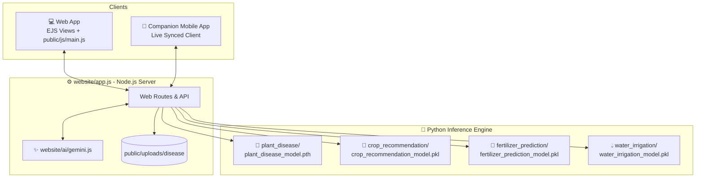

<div align="center">

# 🌱 AgriSense AI

### Smarter Farming. Powered by AI.

[](https://agrisense-ai-y4x6.onrender.com)
[](https://youtu.be/yUclp7JNXGQ)
[](https://github.com/agrisenseai2026b/AgriSense/stargazers)
[](https://github.com/agrisenseai2026b/AgriSense/network/members)
[](https://github.com/agrisenseai2026b/AgriSense/issues)

<p align="center">
  <strong>Four AI models. One agriculture platform.</strong><br/>
  A hybrid Node.js + Python smart agriculture platform combining PyTorch deep learning, Scikit-Learn ML models, Gemini AI, and a synced Web + Mobile experience.
</p>

<p align="center">
  <a href="https://agrisense-ai-y4x6.onrender.com">🚀 Live Web App</a>
  ·
  <a href="https://youtu.be/yUclp7JNXGQ">🎥 Watch Demo</a>
  ·
  <a href="#-four-ai-models">🧠 AI Models</a>
  ·
  <a href="#-project-structure">📂 Repo Structure</a>
  ·
  <a href="#-getting-started">🛠️ Setup Guide</a>
</p>

</div>

---

<details>
<summary><strong>📑 Table of Contents</strong> (Click to expand)</summary>

- [Overview](#-overview)
- [Video Demo](#-video-demo)
- [Four AI Models](#-four-ai-models)
- [Tech Stack](#-tech-stack)
- [System Architecture](#-system-architecture)
- [Project Structure](#-project-structure)
- [Getting Started](#-getting-started)
- [Training the Models](#-training-the-models)
- [Roadmap](#-roadmap)
- [Contributing](#-contributing)
- [License](#-license)

</details>

---

## 🌍 Overview

**AgriSense AI** is an end-to-end precision agriculture platform built with a **Node.js / EJS** web application (`website/`) backed by **Python** machine learning and deep learning pipelines. It monitors farm telemetry, pre-fills field parameters across web and mobile clients, and runs inference across four specialized agricultural AI models alongside **Gemini AI** integration (`website/ai/gemini.js`).

> **Live Deployment:** [https://agrisense-ai-y4x6.onrender.com](https://agrisense-ai-y4x6.onrender.com)  
> *(Hosted on Render—initial cold start may take 30–50 seconds if the server has been idle.)*

---

## 🎥 Video Demo

Click the thumbnail below to watch the full **Web + Mobile App** walkthrough on YouTube:

<div align="center">

[](https://youtu.be/yUclp7JNXGQ)

**[▶ Watch on YouTube (4:16)](https://youtu.be/yUclp7JNXGQ)** — *Live Web Dashboard, Plant Disease Detection, Crop/Fertilizer/Irrigation AI Models, and the synced Mobile App.*

</div>

---

## 🧠 Four AI Models

| Module | Directory | Model Artifact | Framework | Output |
| :--- | :--- | :--- | :--- | :--- |
| 🍃 **Plant Disease Detection** | `plant_disease/` | `plant_disease_model.pth` + `classes.json` | PyTorch (`torch`, `torchvision`) | Class (`Healthy`, `Powdery`, `Rust`), confidence %, & treatment advice |
| 🌾 **Crop Recommendation** | `crop_recommendation/` | `crop_recommendation_model.pkl` | Scikit-Learn + Joblib | Optimal crop based on N, P, K, temperature, humidity, pH, & rainfall |
| 🧪 **Fertilizer Prediction** | `fertilizer_prediction/` | `fertilizer_prediction_model.pkl` | Scikit-Learn + Joblib | Recommended fertilizer blend from soil, moisture, weather, & crop |
| 💧 **Water Irrigation** | `water_irrigation/` | `water_irrigation_model.pkl` | Scikit-Learn + Joblib | Irrigation requirement (`Low` / `Medium` / `High`) & confidence % |

<details>
<summary><strong>🔍 Click to inspect exact input parameters per model</strong></summary>

- **Plant Disease Detection (`plant_disease/predict.py`, `disease_pred.py`):** Leaf image upload (`JPG`, `PNG`, `WEBP` saved to `website/public/uploads/disease/`)
- **Crop Recommendation (`crop_recommendation/predict.py`):** `Nitrogen (N)`, `Phosphorus (P)`, `Potassium (K)`, `Temperature (°C)`, `Humidity (%)`, `Soil pH`, `Rainfall (mm)`
- **Fertilizer Prediction (`fertilizer_prediction/predict.py`):** `Temperature (°C)`, `Humidity (%)`, `Moisture (%)`, `Soil Type`, `Crop Type`, `Nitrogen`, `Potassium`, `Phosphorus`
- **Water Irrigation (`water_irrigation/predict.py`):** `Soil Type`, `Soil pH`, `Soil Moisture (%)`, `Temperature (°C)`, `Humidity (%)`, `Rainfall (mm)`, `Wind Speed (km/h)`, `Crop Type`, `Season`, `Irrigation Type`, `Water Source`, `Field Area (Hectare)`, `Region`

</details>

---

## 🧰 Tech Stack

<div align="center">


</div>

---

## 🏗️ System Architecture



---

## 📂 Project Structure

<details open>
<summary><strong>Click to toggle full repository tree</strong></summary>

```text
AgriSense/
├── crop_recommendation/
│   ├── data/
│   │   └── crop_data.csv
│   ├── models/
│   │   └── crop_recommendation_model.pkl
│   ├── predict.py
│   ├── train_model.py
│   └── requirements.txt
│
├── fertilizer_prediction/
│   ├── data/
│   │   └── fertilizer_data.csv
│   ├── models/
│   │   └── fertilizer_prediction_model.pkl
│   ├── predict.py
│   └── train_model.py
│
├── plant_disease/
│   ├── data/
│   │   ├── Train/Train/{Healthy,Powdery,Rust}/
│   │   ├── Validation/Validation/{Healthy,Powdery,Rust}/
│   │   └── Test/Test/{Healthy,Powdery,Rust}/
│   ├── models/
│   │   ├── plant_disease_model.pth
│   │   └── classes.json
│   ├── disease_pred.py
│   ├── predict.py
│   ├── train_model.py
│   └── requirements.txt
│
├── water_irrigation/
│   ├── data/
│   │   └── irrigation_prediction.csv
│   ├── models/
│   │   └── water_irrigation_model.pkl
│   ├── predict.py
│   └── train_model.py
│
├── website/
│   ├── ai/
│   │   └── gemini.js
│   ├── public/
│   │   ├── css/style.css
│   │   ├── js/main.js
│   │   └── uploads/disease/
│   ├── views/
│   │   ├── index.ejs
│   │   ├── crop.ejs
│   │   ├── fertilizer.ejs
│   │   └── irrigation.ejs
│   ├── app.js
│   ├── package.json
│   └── package-lock.json
│
├── views/
│   └── home.ejs
├── requirements.txt
└── .gitignore
```

</details>

---

## 🚀 Getting Started

Follow the steps below to run **AgriSense AI** locally.

<details>
<summary><strong>1️⃣ Prerequisites</strong></summary>

- **Node.js** (v18+ recommended) & `npm`
- **Python** (3.9+ recommended) & `pip`
- **Git**

</details>

<details>
<summary><strong>2️⃣ Clone the Repository</strong></summary>

```bash
git clone [https://github.com/agrisenseai2026b/AgriSense.git](https://github.com/agrisenseai2026b/AgriSense.git)
cd AgriSense
```

</details>

<details>
<summary><strong>3️⃣ Install Python Dependencies</strong></summary>

Create a virtual environment and install the CPU-optimized PyTorch & ML dependencies from the root `requirements.txt`:

```bash
python -m venv venv

# Activate virtual environment
# Windows:
venv\Scripts\activate
# macOS / Linux:
source venv/bin/activate

# Install all Python packages (PyTorch CPU, TorchVision, Scikit-Learn, Pandas, etc.)
pip install -r requirements.txt
```

</details>

<details>
<summary><strong>4️⃣ Install Node.js Dependencies & Configure Environment</strong></summary>

```bash
cd website
npm install
```

Create a `.env` file (ignored by `.gitignore`) with your required keys—for example, your Gemini API key for `website/ai/gemini.js`:

```env
GEMINI_API_KEY=your_gemini_api_key_here
PORT=3000
```

</details>

<details>
<summary><strong>5️⃣ Launch the Web Server</strong></summary>

```bash
# Inside the website/ directory
node app.js
```

Open your browser and visit `http://localhost:3000` (or the port configured in your `.env`).

</details>

---

## 🏋️ Training the Models

All trained model artifacts are already included, but you can retrain any model from scratch using its dataset and training script:

<details>
<summary><strong>Click to view retraining commands</strong></summary>

```bash
# 1. Crop Recommendation
python crop_recommendation/train_model.py

# 2. Fertilizer Prediction
python fertilizer_prediction/train_model.py

# 3. Plant Disease Detection (PyTorch)
python plant_disease/train_model.py

# 4. Water Irrigation Prediction
python water_irrigation/train_model.py
```

</details>

---

## 🗺️ Roadmap

- [x] Farm Monitoring Dashboard & editable field configuration
- [x] Plant Disease Detection (`Healthy`, `Powdery`, `Rust`) with PyTorch
- [x] Crop Recommendation, Fertilizer Prediction, & Water Irrigation ML models
- [x] Gemini AI integration (`website/ai/gemini.js`)
- [x] Cloud deployment on Render ([agrisense-ai-y4x6.onrender.com](https://agrisense-ai-y4x6.onrender.com))
- [x] Companion Mobile App synced with live server data
- [ ] Full **AgriSense AI Chatbot** experience in the Mobile App `Chat` tab
- [ ] Direct hardware IoT sensor streaming & multi-language farmer support

---

## 🤝 Contributing

Contributions are welcome!

1. **Fork** the repository
2. Create your feature branch (`git checkout -b feature/YourFeature`)
3. Commit your changes (`git commit -m "Add YourFeature"`)
4. Push to the branch (`git push origin feature/YourFeature`)
5. Open a **[Pull Request](https://github.com/agrisenseai2026b/AgriSense/pulls)**

---


---

<div align="center">

Built with 💚 by **[AgriSense AI](https://github.com/agrisenseai2026b)**

**[⬆ Back to Top](#-agrisense-ai)**

</div>
